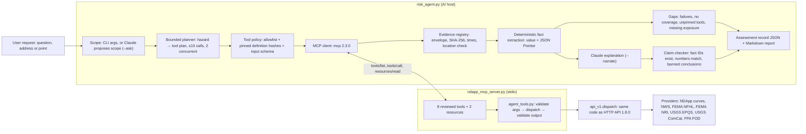
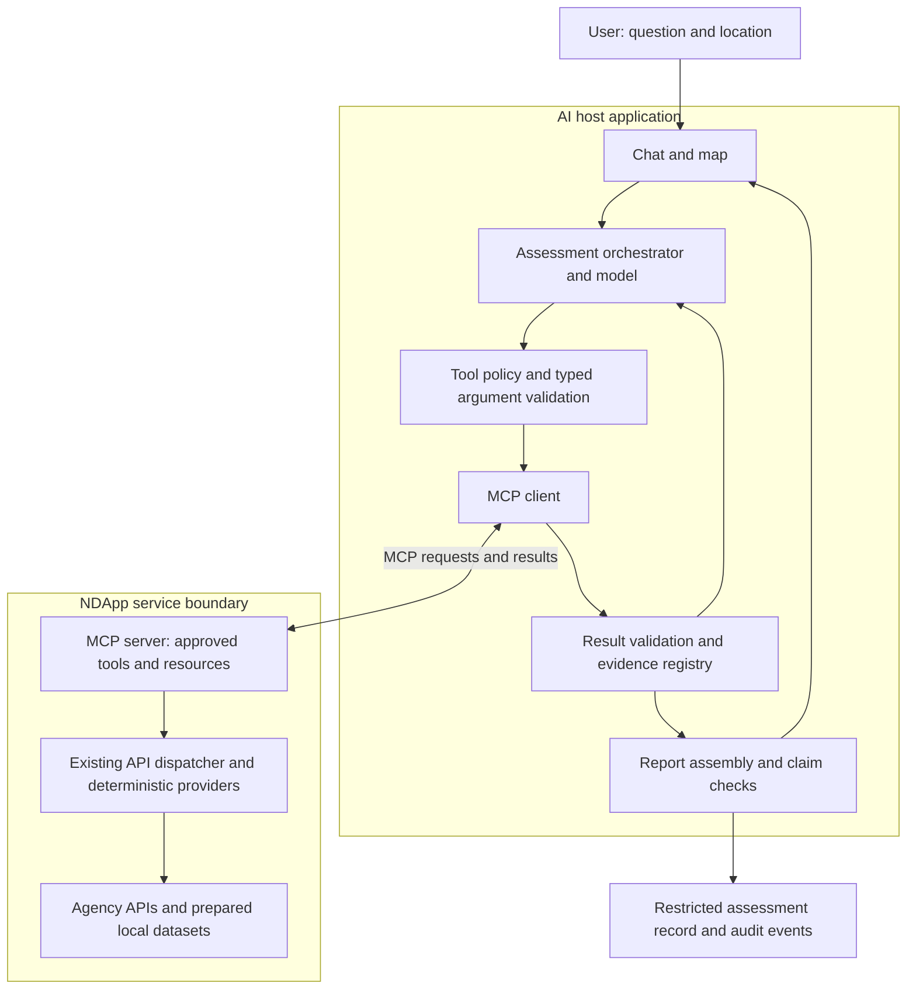

# Natural-disaster assessment agent over MCP

Architecture draft, November 7, 2026. This document proposes an MCP-based agent
for NDApp. It does not implement a host, an MCP server, authentication, or a new
scientific model. The intended risk domain is natural disasters; MCP security
controls support this workflow rather than form its assessment subject.

**Implementation update, November 7:** the first slice below is now built: a
real MCP server, an assessment host with an MCP client, and three more evidence
tools (API 1.8.0). See [Implemented reference architecture](#implemented-reference-architecture)
and [risk assessment tools](risk-assessment-tools.md). Version 1.6.0 references
in the original draft describe the baseline examined for this architecture.

## Implemented reference architecture

| Role | File | What it does / guarantees |
| --- | --- | --- |
| MCP server | `ndapp_mcp_server.py` | Official SDK low-level `Server` over stdio. Read-only tools, input/output schemas taken from the OpenAPI contract, blocking provider calls run off the event loop, unknown tools are protocol errors. Resources: `ndapp://catalog/tools`, `ndapp://methods/evidence-rules`. |
| Tool registry | `agent_tools.py` | Single reviewed list of tools → API routes. Validates arguments before any provider I/O; replaces schema-invalid provider output with an error rather than passing it on. `definition_hash()` supports pinning. |
| Host / orchestrator | `risk_agent.py` | Plans calls from requested hazards (`flood`, `earthquake`, `wildfire`) plus always-on context (alerts, NRI). Concurrency limiter, 45 s per-call deadline, partial results preserved. Status: `complete`, `partial`, `unavailable`, `awaiting_input` (ambiguous address) or `failed`. |
| Tool policy | `risk_agent.ToolPolicy`, `validation/mcp-tool-pins.json` | Discovery never grants permission. Only tools in a reviewed plan are callable; a definition whose hash differs from the reviewed pin is blocked and reported as drift. Pins embed the API version, so a contract change requires re-review (`--write-pins`). |
| Evidence and facts | `EvidenceRegistry`, `extract_facts` | Each call stores tool, arguments, the full `{api_version,status,data,meta}` envelope, a SHA-256 and timestamps. Facts are pulled by code with a JSON Pointer into a specific evidence item; tables are rendered from facts, not model text. |
| AI (optional) | `interpret_request`, `narrate` | Claude Opus 5.5 with JSON-schema structured output. It proposes a scope (validated by code; it never picks tools) and writes statements citing fact IDs. It sees extracted facts only, not raw agency text. Statements with unknown citations, unsupported numbers, or safety/zero-risk/overall-score wording are withheld and counted. Server-side refusal fallback is enabled. |

Agent loop for one assessment: discover → review tools against pins → resolve
address (stop on ambiguity) → run the bounded plan → check each result's location
against the request → extract facts → compute gaps → optional narrative → claim
check → record. The host is deterministic by design: the model reads and explains,
and code chooses and executes tool calls. A future model-driven loop could let Claude
pick tools, but every call would still pass through the same `ToolPolicy.check`.

Verified on November 7, 2026: the stdio server was launched as a subprocess and
driven by the SDK client; a live San Antonio run completed 8 MCP calls in about 21 s
with status `complete` and 48 traceable facts. Seventeen new tests cover the
providers, the server (discovery, invalid arguments before I/O, unknown tools,
invalid evidence), host drift blocking, partial failure, location mismatch,
ambiguous addresses, and the claim checker. Claude calls are tested with a stub
client only. No live model call was made because no API credentials were
configured.

Still open, in priority order: (1) a location-confirmation step in a UI before
parcel-sensitive interpretation; (2) Streamable HTTP transport with auth, quotas
and Origin checks for shared use; (3) asset-profile and vulnerability tools before
any loss estimate; (4) a shared cache/pacing layer for agency APIs; (5) an
evaluation set for narrative quality with real model runs.

## Product boundary

Given a user-selected location and named hazards, return an evidence-backed
hazard screening: source curves, their meaning, coverage, assumptions, and
optional current station context. Explain what the available evidence supports
and what additional inputs a fuller risk assessment requires.

Hazard describes the physical event or conditions. Exposure describes the
people/assets present. Vulnerability describes their susceptibility to damage.
The first release supplies hazard screening. Property loss estimates require
verified asset attributes and an applicable vulnerability model; a location
alone is insufficient. Keep `assessment_type=hazard_screening` explicit.

Initial use case: “Assess flood and earthquake hazards at this location and
show the available evidence.” Current weather is optional context, not a
forecast, a warning service, or an input that silently modifies annual curves.

## Logical architecture

The **host** owns the agent loop, conversation state and execution policy. Its
**MCP client** discovers and calls a server. The **MCP server** exposes a narrow
adapter to NDApp. The **backend** remains the authority for numerical results.
These are logical roles and can share a machine; the model is neither the MCP
client nor the hazard engine. [MCP architecture][mcp-architecture]

The model proposes approved calls and writes explanations. Code validates
arguments, executes calls, checks results and renders authoritative tables.
Calculations, unit conversions, interpolation, threshold selection and rounding
belong in deterministic backend/report code, with named methods.

## Reuse and additions

| Component | Current evidence | Proposed addition |
| --- | --- | --- |
| Hazard backend | `api_v1.py` is version 1.6.0; point hazard, area, trigger comparison, fire history and stations routes exist | Reuse existing dispatcher; add no parallel model implementation |
| Tool handler | `examples/mcp_station_tool.py` validates an address and calls the dispatcher; exports MCP-shaped data | Wrap with a real SDK transport; add reviewed hazard/geocode handlers |
| Data contract | `api_spec.py` and `docs/api.md` define status, units, sources and API envelopes | Runtime schema validation and evidence references |
| User interface | Map, cards and charts exist | Assessment panel, matched-location confirmation and structured report |
| Agent host | No host is established by this draft | One bounded orchestrator with an MCP client and tool policy |
| Durable records/auth | Not supplied by the station prototype | Add before shared access; isolate users and redact sensitive logs |

This extends [the earlier MCP evaluation](mcp-evaluation.md): MCP remains an
adapter over the same functions. Direct tool calling remains an option for an
in-app-only assistant; here MCP is included deliberately to explore external
host interoperability. This document adds a broader assessment workflow and
does not supersede that evaluation's implementation-status statements.

## MCP surface

Use **tools** for validated operations, **resources** for versioned method and
coverage context, and optional **prompts** for user-selected assessment templates.
Prompts are workflow aids, not permission or enforcement mechanisms. Tool
discovery is followed by host-side filtering; discovering a tool never grants
permission to call it. [Tools][mcp-tools], [resources][mcp-resources],
[protocol feature definitions][mcp-spec]

All names below except the existing station handler are proposed:

| Tool | Inputs and behavior | Backend mapping / phase |
| --- | --- | --- |
| `resolve_location` | Full US street address; return match status, candidates and approximate WGS84 coordinates | `/api/v1/geocode`; MVP |
| `get_hazard_curve` | Validated lat/lon, explicit peril, applicable site class; return source curve without alteration | `/api/v1/hazards/{peril}`; MVP allowlist: flood, earthquake |
| `find_nearest_weather_stations` | Existing address + `n` contract; NOAA AWC METAR stations within 200 km | `/api/v1/monitoring-stations`; existing handler, optional MVP context |
| `get_fire_history_context` | Validated lat/lon; clearly distinguish nearest reported fire from historical nearby-fire frequencies | `/api/v1/nearest-fire` and `/api/v1/fire-proximity`; later reviewed handlers |
| `compare_trigger_options` | Location, explicit peril, user-supplied fixed payout; source-supported thresholds only | `/api/v1/trigger-comparisons/{peril}`; later opt-in research illustration |
| `get_area_hazard` | Bounded rectangle and explicit supported peril; describe 25-point sampling | `/api/v1/areas/{peril}`; later, with work limits |

Do not expose `auto` selection in the first assessment: county relevance does
not establish property loss ranking. Add heat, rainfall, tropical-cyclone wind
and wildfire methods individually after documenting each one's coverage and
frequency semantics. The legacy fireline-intensity route is not a substitute
for an annual exceedance curve. Expensive potential-fire preparation requires
a separate long-running-job design rather than a short synchronous tool call.

Suggested resource URIs, to be implemented by this server:

- `ndapp://catalog/hazards`: supported operations, metric definitions and limits.
- `ndapp://methods/{method_id}/{version}`: immutable method notes and assumptions.
- `ndapp://coverage/{dataset_id}/{version}`: published dataset extent and dates;
  a point lookup still decides actual cell availability.

The host retrieves only reviewed resources relevant to the selected methods.
Avoid arbitrary URLs, filesystem paths, SQL or executable arguments. Optional
prompt: `screen_location_hazards`; keep its trusted template versioned locally.

## Assessment workflow

1. **Scope:** collect location, named hazards and purpose. Use a map point or
   full address; clarify missing inputs. Explain address sharing before sending
   it to a model/geocoder under the user's granted data-sharing policy.
2. **Resolve:** geocode once. On ambiguity, request user selection. Show the
   approximate matched point and require location confirmation for parcel-sensitive
   interpretation. Map coordinates bypass address geocoding. Do not invent a site
   class; disclose the backend's BC default as an assumption when used.
3. **Plan:** host builds a bounded list of reviewed tool calls. For the MVP,
   default to at most six calls and two concurrent provider-backed operations;
   these are proposed budgets, to be tuned with measurements.
4. **Retrieve:** call flood and earthquake lookups using the same resolved
   coordinates. Station lookup is optional. Initially its existing handler
   requires an address; add a separately validated coordinate variant before
   supporting station context for map-only requests or avoiding repeat geocoding.
5. **Validate:** check schema, status, location, metric, units and source fields.
   Preserve partial results and absence reasons. Store each accepted response as
   evidence with a stable ID and content hash.
6. **Assemble:** generate facts/tables directly from accepted payloads. Let the
   model explain those facts and select relevant limitations. Each quantitative
   claim must refer to an evidence ID and exact field; reject or regenerate
   unsupported claims before display.
7. **Return:** show the confirmed location, separate hazard sections, source
   links, method/baseline dates, data gaps and required next inputs. Offer a
   repeat lookup as a new timestamped assessment rather than silently updating
   the previous one.

Proposed lifecycle: `collecting_input → resolving_location → awaiting_confirmation
→ retrieving → validating → complete | partial | unavailable | failed | cancelled`.
Location ambiguity returns to input collection. A failure for one hazard can
produce a partial report; failures for all requested hazards cannot produce an
apparently complete assessment.

## Evidence and report contract

Preserve each backend `{api_version,status,data,meta}` envelope in MCP
`structuredContent`; return consistent serialized text where needed by clients.
Define an output schema and validate it at runtime. Distinguish protocol errors
from tool-execution errors; an HTTP 200 with `status=unavailable` is a completed
lookup with no usable estimate. [MCP result contract][mcp-tools]

The host's proposed assessment record contains:

| Field | Contract |
| --- | --- |
| `assessment_id`, `schema_version`, `created_at` | Host-generated identity and report creation time |
| `assessment_type`, `status` | `hazard_screening`; completion state separate from backend status |
| `location` | Coordinates, approximate match/confirmation state, resolution evidence ID |
| `scope` | Requested perils and purpose; explicit method assumptions |
| `evidence[]` | Tool/server identity, validated arguments, raw envelope, hash, retrieval time and schema/method versions when known |
| `hazards[]` | Peril, method, availability, exact metric/unit, curve reference, source/baseline dates and limitations |
| `claims[]` | Claim text plus evidence ID and JSON Pointer for each supporting fact |
| `gaps[]` | Missing coverage, failed lookups, unknown metadata and missing exposure/vulnerability inputs |
| `run` | Host/model/prompt/policy versions, call outcomes, durations and cancellation state |

Do not assume the current API supplies every proposed provenance field. Record
absent model versions/source dates as unknown and add them in the backend when
available. Response generation, retrieval, observation, baseline and model
publication dates are different concepts. Store sensitive evidence under access
control; operational audit logs should use IDs and redacted summaries instead
of duplicating raw addresses and payloads.

Numerical claim checking needs structured report fields, not just a second
model's opinion. Check evidence pointers and values in code, including explicit
deterministic conversions. Render tables without model rewriting. Narrative
causal or comparative claims also require method-specific review rules.

## Scientific and operational rules

- Preserve source frequency meanings: modeled annual probability, historical
  annual frequency, and potential-condition frequency are separate quantities.
  Do not add hazard probabilities or invent a combined 0–100 risk score.
- Missing coverage is unknown, never zero risk. Preserve genuine numeric zeros
  with their method meaning. Historical absence does not establish future safety.
- Do not infer property loss from a hazard curve or price insurance from a
  general narrative. Trigger comparisons remain fixed-benefit research
  illustrations and never initiate payment or settlement.
- Flood coverage depends on installed TWDB Texas tiles; a national geocoder
  does not make the flood model nationwide. A nearby station is a spatial proxy,
  not an on-site measurement. Area averages are not parcel-level extremes.
- Weather observations remain separate from long-term hazard curves. Apply
  backend freshness rules and report missing/stale data without substitution.

## Trust, transport and runtime

For the first local pilot, use one trusted NDApp MCP server over **stdio** and
an existing compatible desktop host as a protocol harness. This validates MCP
before adding a custom chat runtime. Retain the Python backend and handlers;
there is no need to migrate this established stack or choose a model vendor
to define the architecture. A custom host can later implement the orchestration,
evidence and report contract above server-side.

Pin the official SDK and test the exact client/server versions. On November 7,
2026, `/specification/latest` resolves to **2026-07-28**. This revision differs
from older handshake/session tutorials; use SDK-supported compatibility rather
than hand-building protocol messages. Conversation/assessment state belongs
to the host, independently of protocol sessions. [Specification][mcp-spec]

For shared remote access, use **Streamable HTTP** behind HTTPS with validated
Origin, verified identity, audience-bound tokens, per-tool authorization and
quotas. Protect any separate backend from bypass access. Keep credentials out
of model context and avoid token passthrough. [Transport][mcp-http],
[authorization][mcp-auth], [security guidance][mcp-security]

Treat tool descriptions, resources and results as untrusted data. Review and
pin tool definitions, re-review changes and namespace identities by configured
server ID. Enforce permissions in code; tool annotation hints are not security
controls. Constrain provider network destinations and escape rendered text and
links. Tool results cannot authorize another connection, a new tool or sharing
private data. [Annotation trust rules][mcp-tools]

Start with a proposed 30-second backend operation budget and 35-second host
tool deadline for the fast MVP paths. Current provider socket timeouts do not
enforce aggregate deadlines: use bounded/cancellable work, propagate cancellation,
and ignore late results. No automatic retry of an entire assessment; retry only
eligible failed reads under a bounded policy. Shared caching, provider pacing
and capacity limits are required before adding workers. Deadline settings must
be verified with measured upstream behavior.

## First implementation slice and acceptance

1. Add a real MCP SDK server around the station handler; verify discovery,
   listing and execution with a pinned client. Add geocode and explicit
   flood/earthquake tools using existing OpenAPI schemas.
2. Implement the bounded assessment runner, evidence registry and structured
   report. Keep the report contract independent of the chosen host/model.
3. Connect chat/map presentation and location confirmation; add controlled
   persistence, identity and remote transport only when that deployment is needed.
4. Expand methods after per-method evaluations. Add asset/vulnerability modeling
   as a separate phase before calling the product a property-loss assessment.

Acceptance scenarios must cover successful covered lookups, uncovered flood
tiles, ambiguous address, invalid arguments rejected before I/O, a failed hazard
alongside a successful one, stale station observations, units/frequency semantics,
unsupported narrative numbers, injected instructions in results, unauthorized
calls, timeout/cancellation and tool-definition drift. Fixtures establish
contract/agent behavior; live agency smoke checks establish connectivity, not
scientific calibration. No new runtime tests were run for this design-only change.

The next concrete deliverable is the local MCP server and an evidence-backed
two-hazard report for a confirmed point. No loss model, nationwide coverage or
live warning capability is implied by that milestone.

[mcp-architecture]: https://modelcontextprotocol.io/docs/2026-07-28/learn/architecture
[mcp-spec]: https://modelcontextprotocol.io/specification/2026-07-28
[mcp-tools]: https://modelcontextprotocol.io/specification/2026-07-28/server/tools
[mcp-resources]: https://modelcontextprotocol.io/specification/2026-07-28/server/resources
[mcp-http]: https://modelcontextprotocol.io/specification/2026-07-28/basic/transports/streamable-http
[mcp-auth]: https://modelcontextprotocol.io/specification/2026-07-28/basic/authorization
[mcp-security]: https://modelcontextprotocol.io/docs/2026-07-28/tutorials/security/security_best_practices
