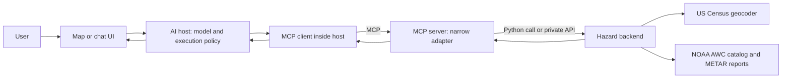

# MCP evaluation and implementation plan

Evaluated **November 3, 2026** against this checkout and current official MCP
documentation. Changes below are proposed unless marked implemented. Nothing was deployed.

## Recommendation

**Use direct backend tool/function calling for the first in-app assistant. Keep
MCP as an optional adapter when an external AI host needs this app's tools.**
The three-station workflow already exists in one API operation. An assistant
adds conversation; MCP adds interoperability, not improved hazard science.

| Choice | Connection and benefit | Cost and fit now |
| --- | --- | --- |
| Direct API/function calling | UI → server-side AI host → allowlisted function or `GET /api/v1/monitoring-stations`. Model proposes typed arguments; host executes. Reuses the existing API/OpenAPI contract. | Fewest components for one app and one assistant. Host-specific tool registration must be maintained. **Recommended first.** |
| MCP wrapper | AI host's MCP client → MCP server → the same dispatcher/providers. Standard tool discovery and invocation can serve multiple compatible hosts. | Adds protocol/SDK compatibility, transport, identity integration, authorization, operations and testing. Worth adding when there is a named external host or a second independent consumer. |

Neither choice supplies a model, UI or access control. Both should use the same
backend operation. MCP servers need no model: the protocol exchanges context/tools.
[Official architecture](https://modelcontextprotocol.io/docs/2026-07-28/learn/architecture).

## Repository findings

Searched the workspace, including hidden files outside `.git`/`.venv`, and every
ancestor directory up to `C:\` for `AGENTS.md`; **none was present**, so none could
be read. Inspected runtime code, tests, API schemas and architecture docs.

| Area | Evidence and implication |
| --- | --- |
| Application server | [`server.py`](../server.py), `Handler` and startup: standard-library `ThreadingHTTPServer` on `127.0.0.1:8000`, serving the map and GET APIs. It is an application web server, not an MCP implementation. Static fallback serves from the repository root; do not expose this development server publicly. |
| APIs | [`api_v1.py`](../api_v1.py), `dispatch`, API **1.3.0**: GET health, geocode, hazards, areas, trigger comparisons and monitoring stations. [`api_spec.py`](../api_spec.py) supplies OpenAPI 3.1 and `/api/docs`. Legacy `/api/*` routes remain; v1 writes return 405. |
| Station capability | `/api/v1/monitoring-stations?address=...&n=3&network=awc_metar` resolves addresses and retrieves observations. [`monitoring_stations.py`](../monitoring_stations.py), `nearest_stations`, ranks unique METAR stations by great-circle distance, then ID, within **200 km**. It neither searches every network nor substitutes farther stations for missing reports. |
| Validation/errors | `parameters` rejects unknown/duplicate/blank query parameters; coordinates must be finite and in range; n is 1–50. [`address_lookup.py`](../address_lookup.py) normalizes whitespace, limits cleaned addresses to 100 characters and preserves spelling/identity. No match or ambiguity returns 422 before station work; provider failures return 502. |
| Authentication | No login, user identity, token validation, scopes, tenant checks, or API security scheme is implemented. Loopback binding limits network reach but is not user authorization. Census and AWC requests use identifying User-Agent headers and no credentials. |
| UI / agents today | [`index.html`](../index.html) and [`script.js`](../script.js), `loadNearestStations`: address/map selection, station count, cards/markers, timestamps, units, links and retry. Browser timeout is 15 seconds; abort does not stop backend work. No chat, model integration, agent runner or MCP implementation was found. HTTP `User-Agent` headers are not AI agents. |
| Deterministic computation | [`hazard_engine.py`](../hazard_engine.py), [`hazard_providers.py`](../hazard_providers.py), [`disaster_data.py`](../disaster_data.py), [`area_hazard.py`](../area_hazard.py) and `api_v1.comparison` contain the existing models/provider transformations. [`heat_context.py`](../heat_context.py) derives station heat screening. Some UI comparison logic also exists in [`hazard_trigger.js`](../hazard_trigger.js); agents should call the backend's calculation path. The engine's trigger evaluator is not an autonomous agent or a settlement service. |

**Calculation boundary:** ranking, freshness checks, heat derivations, hazard
models, interpolation, probabilities and rounding stay deterministic in the
backend. AI selects tools and explains returned facts. Observations must not
alter hazard curves or payouts; tools cannot invent readings or move money.

## Roles and deployment boundaries

| Component | Responsibility |
| --- | --- |
| User interface | Existing map/cards plus an optional chat panel. Collect address, show matched location, consent, progress, cancel/retry, source links and observations. UI renders structured facts directly. |
| Agent / AI host | Runtime coordinating model, conversation, tools, execution policy and consent. Run in-app orchestration server-side; an external AI application can instead be the host. |
| MCP client | Protocol component inside that host, associated with the hazard MCP server. Discovers tools, sends calls and processes results. The LLM itself is not the MCP client. |
| MCP server | Adapter exposing approved tools, validating inputs/permissions and invoking the backend. Can run locally or remotely, colocated with or separate from NDApp. |
| Hazard backend | Existing API dispatcher, provider clients, caches, local rasters and deterministic computations; authoritative producer of numerical results and provenance. |

**“MCP host” means the AI application, not the machine, cloud provider, or Python
server hosting NDApp.** Co-location does not merge these logical roles. The
current browser map alone is not an MCP host. These distinctions follow the
[official participant definitions](https://modelcontextprotocol.io/docs/2026-07-28/learn/architecture).



Direct calling omits C and S. One composite tool avoids model orchestration of
separate geocoding, station-search and observation calls.

## Minimal interaction: three nearest stations

1. User requests the three nearest stations and observations for an address.
   If omitted, ask for the address; never infer a private location.
2. UI/host makes the scope clear: NOAA AWC **METAR stations within 200 km**.
   At connection/setup, obtain consent for the read-only operation and sharing
   the address with the chosen AI provider and Census. Show the pending tool
   call with cancel/deny controls; repeated reads can follow that granted policy.
3. Host selects `find_nearest_weather_stations` with
   `{"address":"100 Dolorosa St, San Antonio, TX","n":3}`. The host validates the
   arguments and identity; the tool validates independently.
4. Adapter calls the fixed monitoring-stations operation. Backend geocodes once;
   an ambiguous/missing match stops the lookup. Host asks for a corrected or more
   specific address rather than choosing a candidate. A unique match is shown
   with its approximate coordinates and verification note.
5. Backend loads/caches the catalog, deduplicates/ranks stations and fetches
   their METAR reports together. Return fewer than three if coverage is insufficient.
6. UI renders structured rows/cards and markers. Host summarizes station name/ID,
   distance, values with units, observation UTC time, freshness and source link.
   Report partial results explicitly. Refresh repeats the call under cache policy.

MCP does not prescribe a chat UI. Tool visibility, invocation indicators and user
control belong in the host/UI. [Official tool interaction model](https://modelcontextprotocol.io/specification/2026-07-28/server/tools).

### Tool contract

Handler: [`examples/mcp_station_tool.py`](../examples/mcp_station_tool.py).

| Field | Contract |
| --- | --- |
| Name | `find_nearest_weather_stations` |
| Input | Object, required `address` string; optional `n` integer 1–50, default **3**. No additional properties. Raw address cap 1,000 characters; backend normalization must yield 1–100 characters without remaining control characters. Reject booleans, numeric strings and fractional n before provider I/O. |
| Fixed choices | `network=awc_metar`, 200 km radius/endpoint. No caller-supplied URL, path, code, credentials or identity. Backend validates geocoder coordinates. A future coordinate variant must require finite WGS84 lat/lon together, exclusive of address. |
| Output | `structuredContent` preserves `{api_version,status,data,meta}` or the backend error envelope. `data` includes network, requested/returned counts, coverage, radius, catalog-fetch time and stations. Each station includes ID/name, coordinates, distance_km, source URL and observation `{status, observed_at?, age_minutes?, values?, message, heat}`. Each measured value retains `{variable,value,unit}`; missing fields remain absent. |
| Schema and flags | `--schema` prints input/output JSON Schemas; output reuses existing API component definitions. Result includes `resultType:"complete"`, `isError` and serialized JSON text as well as structured data. Annotations declare read-only, non-destructive, idempotent, external-data access. These hints do not enforce security, and observations can change between identical calls. |

See the [official tool/result/error contract](https://modelcontextprotocol.io/specification/2026-07-28/server/tools).

### Authentication, authorization and credentials

The local demonstration uses the operator's process identity and public data;
it adds no authentication. Before shared use:

- **First-party assistant:** authenticate at the gateway, protect cookie sessions
  against CSRF, and pass verified identity to tool execution. Require
  `stations:read` and per-user quotas. Model arguments cannot supply identity.
  Enforce future private-project ownership in both backend and adapter.
- **Remote MCP:** protect the endpoint with OAuth 2.1, authorization-code flow
  with PKCE, state and exact redirect validation; advertise protected-resource
  and authorization-server metadata. Validate issuer, signature, audience,
  expiry and scopes per request. Separate authentication (who called) from
  authorization (whether that caller can run this tool). OAuth discovery and
  token use are specified in [official MCP authorization](https://modelcontextprotocol.io/specification/2026-07-28/basic/authorization).
- **Credentials:** host stores OAuth tokens securely outside model context;
  bearer access tokens travel in Authorization headers, never tool arguments,
  URLs, prompts or logs. Keep provider secrets in server-side secret storage or
  narrowly scoped process environment. Use separate audience-bound backend
  credentials or trusted in-process identity; never forward an MCP bearer token
  to Census/NOAA or to a differently scoped backend. Restrict backend ingress so
  its unauthenticated API cannot bypass adapter authorization.
- **Boundary controls:** HTTPS remotely; localhost-only for local HTTP; validate
  Origin when present, restrict permitted hosts and avoid arbitrary URL fetching.
  Grant only this read operation; `tools/list` filtering does not replace
  `tools/call` authorization. Treat provider names/messages as data, never new
  instructions. Render escaped text and allowlisted HTTPS source links. Redact
  addresses/query strings and credentials from access logs; log request ID,
  caller, tool, status and duration with limited retention.

Token passthrough and SSRF are documented MCP risks, not protections supplied by
the protocol. [Official security guidance](https://modelcontextprotocol.io/docs/2026-07-28/tutorials/security/security_best_practices).

### Timeouts, failure semantics and reporting

**Existing:** Census has a 15-second socket timeout. AWC reads have six-second
socket timeouts, compressed/uncompressed response caps, process-local pacing
(one upstream request/second), catalog TTL 24 hours, report TTL 60 seconds and
60-second failure cooldown. AWC's shared lock and sequential calls mean these
are **not an aggregate deadline**; caches/pacing are not shared across workers.

**Proposed:** bound admission/lock waits to one second; enforce a 30-second
backend deadline including geocoding, pacing and provider reads, with each
remaining socket timeout capped by the remaining budget. Host tool timeout
35 seconds; chat UI wait budget 40 seconds with immediate cancel. Use cancellable
I/O or a bounded isolated worker; merely timing out a thread leaves work running.
Propagate cancellation and ignore late results. Do not automatically retry the
whole workflow; respect cooldown/Retry-After and offer explicit retry. Share
cache/rate budgets across workers before scaling. MCP supports configurable
timeouts and transport-specific cancellation. [Official cancellation guidance](https://modelcontextprotocol.io/specification/2026-07-28/basic/patterns/cancellation).

| Outcome | Agent/UI behavior |
| --- | --- |
| Invalid arguments / existing HTTP 400 | Tool execution error `invalid_request`, `isError:true`; request corrected input. No provider call. |
| No unique address / existing HTTP 422 | Preserve `address_not_found` or `address_ambiguous` and candidate details; ask for clarification. |
| Catalog/geocoder failure / existing HTTP 502 | Preserve `provider_unavailable`, `isError:true`; no substituted station results. |
| No stations / HTTP 200 `not_found` | Successful lookup, empty list and coverage explanation; does not imply no hazard. |
| Observation failure / HTTP 200 | Keep station links and distances with `observation.status=unavailable`. Missing/stale readings remain labeled, never zero-filled or replaced with model guesses. Top-level `available` alone does not establish fresh observations. |
| Future deadline / capacity / rate limit | Add explicit `deadline_exceeded`, `busy` or `rate_limited` codes and retry guidance to the adapter contract; transport 504/503/429 where applicable. These codes are not implemented in the current v1 schema. |
| Future authentication/permission failure | HTTP 401 with appropriate OAuth challenge, or 403 for insufficient permission; execute nothing. |
| Malformed MCP request / unknown tool | Protocol-level JSON-RPC error; distinct from provider/tool execution errors. |

Every answer must distinguish `meta.generated_at` (response time),
`catalog_fetched_at` (catalog retrieval), and each `observation.observed_at`
(measurement time), showing UTC and optionally localized display. Preserve units,
network/radius, matched address, Census source and each NOAA station link.
Reports older than two hours are stale under **this app's** rule; timestamps more
than five minutes in the future are ignored. “Latest” means latest returned by
AWC, possibly cached, not guaranteed real-time telemetry. Current code discards
the reports' retrieval timestamp and provides no separate geocoding timestamp;
retain those as additive backend provenance fields before production rather
than inventing them in the agent. Scientific model version/source dates remain
separate from all retrieval times.

## Local prototype and evidence

The new script is a **transport-free tool handler**, not a complete MCP server
or an AI host. It calls the real v1 dispatcher in-process, exports an MCP-shaped
tool definition/result and performs no application-data writes. It requires no
new packages, deployment, running web server or model credentials. Socket timeouts
are inherited; authentication, runtime output-schema enforcement and an overall
deadline remain future work. Schema conformance is checked in tests.

```powershell
.\.venv\Scripts\python.exe examples/mcp_station_tool.py --schema
.\.venv\Scripts\python.exe examples/mcp_station_tool.py --address "100 Dolorosa St, San Antonio, TX" --n 3 --output validation/mcp-stations-live.json
.\.venv\Scripts\python.exe -m unittest discover -s tests
```

Live result saved in [`validation/mcp-stations-live.json`](../validation/mcp-stations-live.json),
generated **2026-11-03T23:49:48Z** (5:49:48 p.m. America/Chicago). Census matched
`100 DOLOROSA, SAN ANTONIO, TX, 78205`; all three observations were available at
capture time. This verification snapshot is not continuously updated.

| Station / NOAA source | Distance | Observed UTC | Air temperature |
| --- | ---: | --- | ---: |
| [KSKF](https://aviationweather.gov/data/metar/?id=KSKF) | 9.22 km | 2026-11-03T22:55:00Z | 27.6 °C |
| [KSSF](https://aviationweather.gov/data/metar/?id=KSSF) | 9.70 km | 2026-11-03T22:53:00Z | 27.8 °C |
| [KSAT](https://aviationweather.gov/data/metar/?id=KSAT) | 13.38 km | 2026-11-03T22:51:00Z | 26.7 °C |

**Validation:** all **112 Python tests passed**, including five new boundary
tests in [`tests/test_mcp_station_tool.py`](../tests/test_mcp_station_tool.py).
They exercise rejection before I/O, real backend sorting, preservation of zero
values/units/stale/missing readings, ambiguity stopping station work, provider
errors, partial observation failures and output-schema/text consistency.
The live run exercises Census and NOAA through the same handler; it does not
claim MCP wire-protocol interoperability or a model-driven interaction test.

## Next steps

1. **First-party pilot:** register this one operation with the chosen server-side
   AI host, add chat/progress/cancel UI, render backend facts in existing cards,
   and test clarification, stale/partial results and cancellation end to end.
   Ordinary map/API use stays available without AI.
2. **Before shared access:** implement identity, read authorization, address/log
   privacy, bounded work/deadlines, report/geocode retrieval timestamps and
   runtime response validation. Replace the repository-root development server
   with a production gateway/static-serving boundary.
3. **When an external host is selected:** wrap the same handler with a pinned
   [official MCP SDK](https://github.com/modelcontextprotocol/python-sdk).
   Start with local **stdio** for a trusted desktop integration; use protected
   **Streamable HTTP** for remote hosts. Keep backend imports for a colocated
   adapter, or use an authenticated private API when deployed separately.
4. **Verify the exact host/SDK protocol pair.** `/specification/latest` resolved
   to **2026-07-28** during this evaluation. That revision uses per-request
   version/identity/capabilities metadata and `server/discover`; earlier revisions
   use `initialize`. Implement compatible fallback through the SDK rather than
   copying an older handshake tutorial. [Official versioning](https://modelcontextprotocol.io/specification/2026-07-28/basic/versioning).
   Current HTTP uses POST to one MCP endpoint with required metadata headers;
   protocol sessions and the standalone GET event stream are removed. Validate
   Origin and bind local HTTP to loopback. [Official HTTP transport](https://modelcontextprotocol.io/specification/2026-07-28/basic/transports/streamable-http).
   Test discovery, tools/list, tools/call, schemas, errors, cancellation and
   unauthorized calls using the selected host and an MCP test client.
5. **Expand only with a concrete need:** expose narrowly scoped read-only hazard
   lookups after the station pilot. Retain backend calculations/provenance and
   explicit unavailability. Do not expose arbitrary SQL, filesystem access,
  provider URLs, policy changes or payout execution through this adapter.
