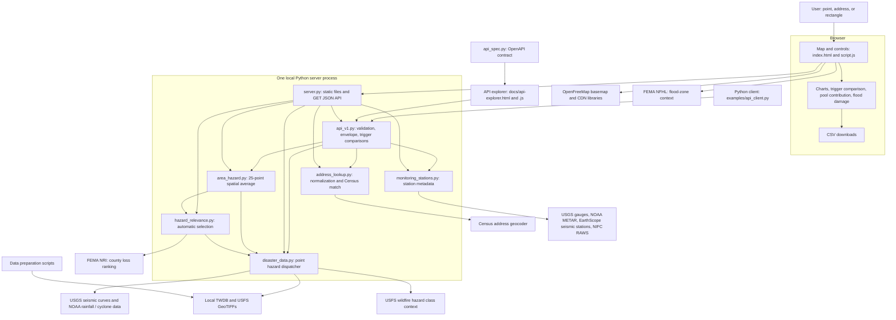
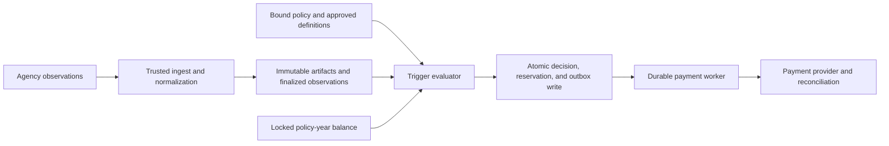

# Natural Disaster Risk Analysis System Architecture

**Current fire options:** the map offers the historical-weather potential-intensity
prototype and the existing FSim flame-length curve. The Texas-only TxWRAP option
has been removed from the map because it supplies no annual exceedance curve.
Its legacy research API and [methods](fireline-intensity.md) remain available.
The remaining architecture description below covers the prior reporting week.

This describes the implementation for the week of October 21–28, 2026 (America/Chicago). It separates the running application and research API, executable research libraries, and proposed persistent insurance workflow. This week’s API and address changes were exercised with automated tests and selected live lookups; those checks do not establish independent model calibration.

## 1. System boundary

The application is a local natural-disaster research application. A browser displays a map, retrieves location-specific hazard curves, calculates a trigger's exceedance result, and estimates a fixed annual pool contribution. Flood also has an exploratory structure-damage model.

The runtime is a modular monolith: one Python process serves static browser assets, existing map endpoints and the versioned research API. The Python client and API explorer access the same provider functions as the map. Python modules divide responsibilities inside that process. Government web services and local GeoTIFF files supply the environmental data.

The repository also contains a standalone research engine for tiered pricing and evidence-based trigger decisions. A PostgreSQL/PostGIS schema describes a future system for retaining models, observations, policies, and payout decisions. That database and settlement workflow are not connected to the application.

## 2. Running application

The arrows represent requests and data dependencies, rather than deployment into separate services.

### Browser responsibilities

This week’s monitoring update displays the nearby station’s identity, network, coordinates and distance, with an orange map marker and a provider link. The interface can fit both locations on the map and retry failed searches. Point mode searches from the selected point and area mode from the rectangle’s center. Catalog station metadata remains separate from modeled hazard curves and does not supply live readings to trigger calculations.

| File | Responsibility |
|---|---|
| `index.html` | Page structure, controls, inline styles, and script loading |
| `script.js` | Map interaction, application state, HTTP calls, response validation, result rendering, and CSV export |
| `hazard_chart.js` | SVG hazard charts; frequency on X and severity on Y |
| `hazard_trigger.js` | Supported trigger levels, probability labels, duplicate-level frequency ranges, and fixed-benefit contribution calculation |
| `damage_model.js` | Four Hazus 4.0 RES1 structure-damage curves and linear interpolation |

Leaflet handles map interaction and overlays. MapLibre renders the OpenFreeMap vector basemap through its Leaflet adapter. These libraries load from a CDN; there is no frontend build pipeline in the current application.

Selection, loaded results, building inputs, and payout inputs live in browser memory. CSVs are created in the browser. The current UI does not persist selections or create policies on the server.

On a location change, `script.js` clears previous results, aborts obsolete requests, and increments a selection version. Responses are checked against that version so an older lookup cannot overwrite the latest selection. Browser cancellation does not guarantee cancellation of work already running in Python.

### Server responsibilities

`server.py` uses Python's `ThreadingHTTPServer` and `SimpleHTTPRequestHandler`, binding to `127.0.0.1:8000` by default. A `--port` argument supports another local port. It serves the project directory and dispatches these read-only endpoints:

| Endpoint | Purpose |
|---|---|
| `/api/geocode` | Resolve a US street address through the Census geocoder |
| `/api/disaster` | Return one viewer curve; `peril=auto` runs automatic selection |
| `/api/disaster-area` | Average local probabilities over a rectangular 5×5 grid |
| `/api/monitoring-station` | Find nearby station metadata for supported hazards |
| `/api/depths` | Return the four TWDB flood depths in source feet |
| `/api/hazards` | Return the separate structured research-model bundle |
| `/api/v1/hazards/{peril}` | Versioned point lookup using coordinates or a US street address |
| `/api/v1/trigger-comparisons/{peril}` | Compare supported point thresholds for a shared fixed payout |
| `/api/v1/areas/{peril}` | Wrap the existing 25-point average and sample metadata |
| `/api/v1/monitoring-stations` | Wrap the existing nearest-station lookup |
| `/api/v1/geocode` | Inspect normalization and address-match outcomes |
| `/api/v1/health` | Check the local API without checking upstream services |
| `/api/v1/openapi.json` and `/api/docs` | OpenAPI 3.1 specification and interactive explorer |

Invalid inputs generally produce HTTP 400. Upstream failures caught by the handlers produce HTTP 502. A valid request without model coverage can return HTTP 200 with `status: unavailable`. JSON responses use `Cache-Control: no-store` and reject nonfinite JSON numbers.

The current v1 release is `1.1.0`. Its envelope contains `api_version`, `status`, `data` and `meta`, retaining original sources, units and assumptions. HTTP 400 identifies invalid input, 422 identifies unresolved or ambiguous calculation addresses, and 502 identifies provider failure. Valid lookups can still return unavailable data. Existing unversioned response formats remain compatible.

Point v1 routes accept either `address` or both `lat` and `lon`. Shared `address_lookup.py` removes extra whitespace without inventing spelling corrections. A unique Census match supplies approximate coordinates and `meta.location` provenance. No match or multiple distinct matches stops the calculation. `/api/v1/geocode` itself reports these outcomes without calculating a hazard. A matched address can still have missing hazard coverage.

The server uses standard-library networking and JSON processing. Rasterio handles geospatial raster reads and transformations. There is no runtime database connection, user authentication, queue, or payment integration.

## 3. Data sources and normalization

`disaster_data.py` presents five viewer hazards through a shared response structure. Each curve identifies its hazard, metric, unit, frequency label, source, notes, availability, and a list of `{severity, frequency_pct}` points.

The common shape simplifies rendering. It does not make all five scientific quantities interchangeable.

| Viewer hazard | Input | Transformation and meaning |
|---|---|---|
| Earthquake | USGS NSHM static PGA curves, through `hazard_providers.py` | Choose a supported regional model and site class; convert acceleration from g to %g and annual rate λ to annual probability `1 − exp(−λ)` |
| Rainfall | NOAA Atlas 14 annual-maximum CSV | Extract the 24-hour rainfall row in millimeters; annual exceedance probability is `1 / return period` |
| Flood | Installed TWDB scenario-5 depth GeoTIFFs | Sample the selected cell for 20%, 10%, 1%, and 0.2% annual-chance scenarios; convert source feet to meters for the viewer |
| Wildfire | Installed USFS FSim BP, FLP5, and FLP6 rasters | Estimate annual flame-length exceedance at 8 ft and 12 ft using burn probability times conditional flame-length probability |
| Cyclone | NOAA NHC HURDAT2 best-track wind radii | Count complete years with a sampled wind footprint at 34, 50, and 64 knots; report observed annual frequency |

The cyclone viewer measures sustained wind. The research engine's joint storm model uses wind gusts and rainfall; those definitions cannot be substituted for one another.

FEMA NFHL flood-zone attributes and the USFS wildfire hazard-potential class add context. Neither is used as a numerical substitute for the hazard curve.

Missing coverage remains missing. TWDB zero/NoData is treated as ambiguous and left blank. A genuine zero frequency from other sources can remain visible in manual mode. Automatic selection requires a usable positive severity/frequency point.

### Raster preparation and installed coverage

`prepare_data.py` downloads and extracts TWDB event tiles into `data/twdb/<event>/<tile>.tif`. `prepare_fire_data.py` extracts selected original USFS raster entries using HTTP byte ranges and records checksum metadata in `data/usfs/`.

At inspection, the four TWDB rasters for tile `n29w99` were installed, together with CONUS USFS BP, FLP5, and FLP6 rasters. This is a file inventory, not a validation of every raster cell. New map clicks sample installed files; they do not automatically install missing regional datasets.

Some government text and catalog downloads use bounded in-process caches keyed by a daily bucket. Station downloads use ten-minute buckets. These caches disappear when the Python process restarts; they are not a durable source archive.

## 4. Point selection, step by step

1. A map click gives latitude/longitude. An address first passes through `/api/geocode` and then follows the same selection path.
2. The browser updates the marker and selection version, clears old results, and requests `/api/disaster`.
3. A manual hazard goes directly to its source handler. Automatic mode first queries FEMA county context and checks candidate curves.
4. The handler retrieves an agency curve or samples local raster data, validates it, converts units, and returns a normalized viewer response.
5. The browser populates the curve, table, source attribution, and supported trigger choices.
6. Station metadata loads independently. Manual selections can start that lookup alongside the curve; automatic selections wait for the resolved hazard.
7. Flood additionally loads `/api/depths` for its editable depth/damage table and queries FEMA NFHL directly from the browser.
8. Selecting a trigger and entering a payout calculates the displayed contribution locally. Exports also happen locally.

The comparison table added this week uses all supported trigger levels, one shared payout and a selectable active row. It updates with payout changes, retains duplicate-level frequency ranges and discloses area sample coverage. Missing values and invalid payouts do not become estimates.

The source-backed trigger values are retained separately from editable flood scenarios. Changing a flood table entry or loading the illustrative example does not change the government trigger probability.

## 5. Automatic hazard selection

`hazard_relevance.py` intersects the coordinate with FEMA's county NRI layer. It ranks earthquake, hurricane, wildfire, and flooding by county expected annual loss in a shared dollar unit. Flood combines the known inland and coastal components.

It checks local curves in ranking order and chooses the highest-ranked supported hazard with a usable curve. If inland flooding dominates but flood-depth coverage is unavailable, rainfall may be shown with an explicit related-context explanation. If the county ranking cannot support a choice, the implementation tries an explicit data-availability fallback: rainfall, earthquake, wildfire, cyclone, then flood.

Responses retain ranking context, checked candidates, reasons for skipping them, and the selection method. This is a regional selection heuristic. It does not infer property risk by comparing rainfall millimeters with earthquake acceleration or wind speed.

## 6. Rectangle selection and spatial averaging

`area_hazard.py` places 25 equally weighted sample locations on a 5×5 grid including the edges and center. Up to six worker threads retrieve point curves concurrently. In automatic mode, county context at the centroid chooses one hazard that stays fixed across all 25 samples.

For each common severity threshold `x`, the module evaluates the local probability at that same threshold and computes:

`average_probability(x) = sum(valid local probabilities at x) / number of valid local probabilities at x`

Exact source values are used directly. Otherwise, valid complete monotone brackets allow log-probability interpolation in severity. The implementation does not extrapolate past source limits or interpolate through a zero-frequency bracket. Missing values are excluded; valid zeros are included. Each threshold retains its denominator, missing/interpolated counts, and individual sample values.

For example, if four usable samples have probabilities of 1%, 2%, 3%, and 0%, their mean is 1.5%. A fifth missing sample does not change the denominator to five.

The output describes the mean local probability at sampled locations. It does not calculate the probability of an event occurring anywhere in the rectangle; that would require spatial dependence modeling. It also does not read every raster cell. Different thresholds may use different subsets of the grid.

In rectangle mode, station lookup, FEMA flood context, and the exploratory flood-depth/damage table describe the centroid. The area trigger and area curve describe the spatial average. The area CSV contains both average rows and sample rows.

## 7. Three calculations with different roles

### Displayed pool contribution

`hazard_trigger.js` uses the selected source level and the fixed benefit entered in the UI:

`expected annual contribution = probability fraction × fixed payout`

For example, 1% and $50,000 produce $500 per year. Coincident severity levels with conflicting source frequencies produce a contribution range. Cyclone uses its observed frequency, and wildfire uses its research estimate, with corresponding labels.

`api_v1.py` implements the same point comparison grouping and probability-times-payout calculation server-side, with contributions rounded to USD cents. `examples/api_client.py` supports addresses or paired coordinates, prints the resolved location, and exports full JSON or comparison CSV. Alternative trigger rows are not added together.

This calculation does not include expenses, capital, reinsurance, portfolio correlation, or a payment transaction. For an area, its input is the mean local probability; interpreting that as a contribution still depends on how the proposed benefit assigns location exposure.

### Exploratory flood damage

`damage_model.js` subtracts first-floor height from modeled ground-level flood depth and interpolates the chosen Hazus 4.0 residential curve. The four choices cover one/two stories with/without a basement. The output is structure damage as a percentage of replacement value. Inputs outside the curve's −4 to 24 ft range produce no estimate.

This damage percentage is separate from both the trigger probability and the fixed payout. The UI does not derive its fixed payout from the Hazus damage percentage.

### Standalone research pricing and trigger engine

`hazard_engine.py` contains executable Python types and pure calculations:

- `HazardCurve`: monotonic curve validation, supported interpolation, and rate/probability conversion.
- `StormCatalog`: paired same-event rain/gust thresholds with AND/OR logic and annual occurrence weights.
- Wildfire helpers: annual burn/intensity factorization and allocation of annual hazard across supplied daily scores.
- `Tier` and `benchmark_quote`: nested cumulative benefits and explicit pricing loads.
- `Policy`, `Observation`, and `evaluate_trigger`: evidence-based eligibility and annual top-up decisions.

For cumulative payouts `B_j` and tier probabilities `p_j`, expected annual payout is:

`E[payout] = Σ (B_j − B_(j−1)) × p_j`, with `B_0 = 0`.

The benchmark adds a risk load and fixed expense, then accounts for an expense ratio. With a single tier and zero loads it reduces to `p × B`.

The trigger evaluator checks location and event identity, metric definition, canonical units, approved source, timestamps, finality, quality, revision, and evidence-hash format. It computes the higher tier's cumulative target minus the policy-year amount already paid. The caller must authenticate observations, verify their provenance, and supply locked ledger state; a hash string alone does not authenticate a measurement.

These quote and trigger functions are not exposed through the current browser workflow. There is no `/api/quote` or payout-execution endpoint.

## 8. Research data contract and integration boundary

`/api/hazards` uses `hazard_providers.py` and `schemas/hazard-location.schema.json` for a versioned research bundle. It includes location, one-year reference duration, rating status, measurement definitions, source/model metadata, curve representation, and explicit unavailable entries.

This endpoint differs from `/api/disaster`, which returns the simpler viewer response consumed by `script.js`. JSON Schema tests check the research contract; the HTTP handler does not run a general JSON Schema validator on every response.

The research bundle has coordinate adapters for USGS earthquake and TWDB flood. Earthquake requires an explicitly selected model and site class; TWDB requires a complete, strictly ordered set of scenario depths. Its rain/wind and wildfire entries are still unavailable placeholders even though the viewer has separate rainfall, cyclone, and wildfire displays. The five viewer hazards and the four research perils therefore represent different integration stages.

## 9. Proposed persistence and settlement architecture

`database/hazard_schema.sql` is explicitly a PostgreSQL 15+/PostGIS blueprint and is not applied by the application.

| Table group | Intended role |
|---|---|
| `insured_location` | Point, footprint, elevation, coordinate accuracy, and datum |
| `source_artifact`, `metric_definition` | Immutable raw evidence references and exact measurement semantics |
| `hazard_model`, `model_artifact`, curve/surface/catalog rows | Versioned models, source linkage, probabilities, and assumptions |
| `monitoring_assignment`, `environmental_event`, `observation` | Approved sources, canonical event identity, normalized readings, and revisions |
| `policy_term`, `benchmark_quote` | Bound contract/model references and reproducible quote inputs/outputs |
| `annual_payout_balance`, `trigger_decision`, `payout_outbox` | Annual limits, auditable decisions, idempotent payment submission |

This diagram describes the intended integration; the ingest service, persistent ledger, outbox worker, and payment provider are not running components of the current app.

The proposed transaction locks the annual balance, loads immutable terms and observations, evaluates the trigger, records a unique decision, reserves any amount due, and inserts an outbox entry before committing. A durable worker submits with an idempotency key and reconciles receipts. That boundary is intended to prevent replay and concurrent-worker double payment.

## 10. Verification and operating limits

The repository contains Python tests for the engine, providers, schema, source transformations, automatic selection, spatial aggregation, and station searches. JavaScript tests cover charts, trigger/contribution calculations, rectangle selection, and area UI behavior. Validation scripts and saved artifacts provide API and San Antonio flood-flow cross-checks.

Verification for this week passed 86 Python tests and four JavaScript entry points. Added checks cover v1 contracts, address normalization and match failures, invalid location combinations, source ranges and zeros, client exports and legacy route compatibility. Selected live checks exercised point/area/station lookups and unavailable coverage, normalized extra spaces, one tolerated typo and a blocked nonexistent address. These checks address software behavior and data flow rather than observed-event calibration or production insurance readiness.

The present deployment boundary is one local Python server, one browser session, local raster files, and external government services. Network access is needed for the basemap, CDN libraries, and agency requests. Raster coverage and upstream service availability affect results. Concurrent area requests can multiply upstream work, and browser cancellation does not stop all server-side calls. Durable caches, shared job control, persistent policy/evidence storage, authenticated ingestion, and settlement services are future integration work.

### Public API deployment work still required

Public hosting was discussed but no cloud service, account, billing change or public deployment was created. A pilot requires a production server, controlled static-file routes, configurable dataset storage, HTTPS and API access/rate/concurrency controls. Persistent storage must retain the supported flood and wildfire files across restarts and deployments. Current local data is about 2.2 GB; additional flood tiles increase the requirement.

Preloading a declared coverage area supports predictable lookups. Automatic installation of missing flood tiles remains unimplemented and would require background jobs, progress reporting, per-tile locking, download verification, storage limits and failure recovery. These are future operating components, not current architecture. Render with a persistent disk and Fly.io with a volume were researched as possible hosts; neither was selected or provisioned. Hosting does not supply additional scientific coverage.

Other proposals remain future research: modeled damage versus payout comparisons, correlated pool/reserve simulations, multiple-location comparisons, reproducible PDF reports and validation against compatible observed events.

## Source guide

- Runtime entry point and routes: `server.py`
- Versioned API and contract: `api_v1.py`, `api_spec.py`, `docs/api.md`
- Shared address matching: `address_lookup.py`
- Python client and explorer: `examples/api_client.py`, `docs/api-explorer.html`, `docs/api-explorer.js`
- User flow and exports: `script.js`, `index.html`
- Viewer sources: `disaster_data.py`
- Automatic choice: `hazard_relevance.py`
- Spatial aggregation: `area_hazard.py`
- Station metadata: `monitoring_stations.py`
- Browser calculations: `hazard_trigger.js`, `damage_model.js`, `hazard_chart.js`
- Research models and decisions: `hazard_engine.py`, `hazard_providers.py`
- Research JSON contract: `schemas/hazard-location.schema.json`
- Proposed persistent model: `database/hazard_schema.sql`
- Related design documents: `docs/disaster-viewer.md`, `docs/parametric-hazard-design.md`
